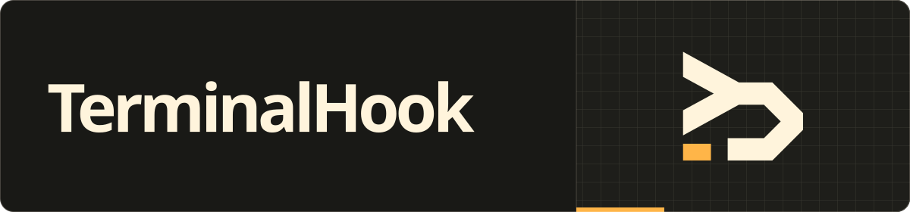

# TerminalHook

English | [简体中文](README.zh-CN.md)

[](https://github.com/BANG404/Codex_Terminalhook/actions/workflows/ci.yml)
[](LICENSE)



TerminalHook is a Rust MCP server and Codex plugin for durable background commands,
event-driven task dashboards, and completion delivery to the originating chat.
Codex submits long or unpredictably timed work once, ends the turn, and receives
the saved result when it finishes. Native workers wait without model polling and
survive MCP disconnection.

Native testing and distribution cover Windows x64, Linux x64/ARM64, and macOS
Intel/Apple Silicon. Commands use separate stdout/stderr pipes and closed stdin.
Windows Job Objects and Unix process groups contain command descendants.

Use the host terminal for quick or interactive commands.

[Installation](#installation-and-upgrades) · [Task tools](#task-tools) ·
[Task panel preview](docs/background-tasks.md#task-panel-preview) ·
[Releases](https://github.com/BANG404/Codex_Terminalhook/releases) ·
[Development and releases](docs/releasing.md)

## Installation and upgrades

### Install the stable version

Have Git and the Codex CLI on PATH. Use PowerShell 7 on Windows x64 or Python
3.11+ on Linux and macOS. The installer selects the prebuilt Git marketplace for
your OS and architecture. The installed MCP binary runs without Rust, Python, or Node.

Get the installer scripts and enter the checkout.

```sh
git clone --depth 1 --branch main https://github.com/BANG404/Codex_Terminalhook.git
cd Codex_Terminalhook
```

From the checkout root, run the installer for your platform.

**Windows**

```powershell
pwsh -NoProfile -File scripts/install.ps1 -Channel production
```

**Linux and macOS**

```sh
sh scripts/install.sh --channel production
```

The installer registers the binary marketplace, installs and enables
`terminalhook@terminalhook-local`, and configures direct tool calls. It retains
the plugin ID and user settings when migrating a local install. If registration
fails during migration, it attempts to restore the previous source and tracking
ref. The checkout supplies the installer scripts. The marketplace supplies the
binary, MCP configuration, and runtime skill.

### Desktop shared host

If `submit_task` reports that Windows or macOS Desktop has no reachable shared
endpoint, quit Desktop. In an external terminal, enter the matching extracted
Release ZIP directory or the `terminalhook-local` Git marketplace root shown by
`codex plugin marketplace list`. Run the launcher for your platform.

| Platform | Launcher |
| --- | --- |
| Windows | `pwsh -NoProfile -File ./Start-DesktopSharedHost.ps1` |
| macOS | `sh ./Start-DesktopSharedHost.sh` |

Open or reopen the chat in the Desktop session started by the launcher and
submit the task there. If the shared host is still unavailable, use the host
terminal. See the [background host troubleshooting guide](docs/background-tasks.md#connection-diagnostics-and-desktop-compatibility).

### Upgrade and migrate settings

Codex refreshes configured Git marketplaces and installed plugin caches on
startup. To refresh the currently tracked channel manually, run the following
command.

```sh
codex plugin marketplace upgrade terminalhook-local
```

The update follows the configured Git branch. To apply the current host
settings to an older installation, run the installer from an up-to-date
checkout with the same channel (`-Channel` on Windows, `--channel` on
Linux/macOS). For a local installation,
pass its package directory with `-Source` or `--source`. The installer adds
`mcp__terminalhook` to `features.code_mode.direct_only_tool_namespaces` and
sets `approval_mode = "approve"` for `submit_task` when neither that tool nor
its TerminalHook server already has an approval mode. Open a new chat after
updating or migrating to load the current tool catalog. Durable workers
continue independently.
[Codex marketplace commands](https://learn.chatgpt.com/docs/developer-commands#codex-plugin-marketplace)

To switch to a published preview channel, pass `alpha`, `beta`, or `rc` to the
installer's channel option. See [release channels and marketplace branches](docs/releasing.md#cd--manual-publication).

### Offline installation and local development

For offline installation or local development, download the ZIP matching your OS/architecture from [GitHub Releases](https://github.com/BANG404/Codex_Terminalhook/releases), extract it to a permanent directory, and run `pwsh -NoProfile -File ./install.ps1 -Source .` on Windows or `sh ./install.sh --source .` on Linux/macOS. Use an extractor that preserves executable permissions, such as `unzip` on Unix. Without a local source option the installer selects Git stable. CI preview ZIPs are also available in [Actions artifacts](https://github.com/BANG404/Codex_Terminalhook/actions).

To build and install a local source snapshot:

```powershell
pwsh -NoProfile -File scripts/package.ps1
pwsh -NoProfile -File scripts/install.ps1 -Source ./dist/package
```

On Linux/macOS, build with `python3 scripts/package.py --channel development`, then install with `sh scripts/install.sh --source ./dist/package`. Native source builds require the pinned Rust toolchain, Python 3.11+, and Node.js 20.19+ or 22.12+ with npm to bundle the Svelte dashboard. Linux binaries use glibc (built on Ubuntu 24.04); Alpine/musl and Windows ARM64 are not release targets. macOS artifacts are unsigned and not notarized.

`package.ps1` generates the ZIP and `dist/SHA256SUMS.txt`. Keep the local package
directory available and rerun the installer after local changes.

The [standalone MCP example](examples/standalone.config.toml) includes the same
approval default. Enable one integration per chat to avoid duplicate tools.
Enablement in a project's `.codex/config.toml` applies to trusted projects with
the plugin already installed. MCP commands use the local account's OS
permissions and run outside the per-command sandbox of Codex's built-in shell.

### Uninstall

```powershell
codex plugin remove terminalhook@terminalhook-local
codex plugin marketplace remove terminalhook-local
```

## Task tools

| Tool | Behavior |
| --- | --- |
| `submit_task` | Start a long or unpredictably timed command under a stable `task_key` and immediately return its task ID |
| `list_tasks` | Explicitly inspect the originating chat's tasks without opening a panel |
| `get_task` | Inspect a saved result, execution state and delivery receipt for diagnosis |
| `cancel_task` | Cancel an explicitly selected background task and clean up its process tree |
| `retry_delivery` | Retry a saved result whose delivery failed before submission; never rerun the command |
| `watch_tasks` | App-only subscription to the current task’s native state events |

Call tools directly in the `mcp__terminalhook` namespace. The installer adds this
namespace to `[features.code_mode].direct_only_tool_namespaces` while preserving
other settings. A manual plugin installation needs the same host configuration.
TerminalHook uses native events and host callbacks for completion delivery.

When an in-scope command is expected to take a long time or may wait for an
unpredictable duration, use `submit_task` proactively. The user's task request
is sufficient to choose background execution. Submit directly with
`submit_task`. A new submission requires a reachable shared Codex daemon, CLI
proxy, and host-provided `threadId` metadata. The tool checks these before
launch and returns the specific error if validation fails. See
[Desktop shared host](#desktop-shared-host) for the Windows and macOS launchers.

The following example submits a build.

```json
{
  "task_key": "build-project-2026-11-17",
  "program": "sh",
  "args": ["-c", "./build.sh"],
  "cwd": "/absolute/path/to/project"
}
```

On Windows, use a native executable or `pwsh -NoProfile -Command` with an absolute
native working directory. For PowerShell UTF-8 output, dot-source the packaged
`skills/terminal-wait/scripts/Initialize-Utf8.ps1` in that same PowerShell process.
Commands are argv arrays; explicitly invoke a shell for shell syntax.

`submit_task` returns `task_id`, `worker_pid`, and `state_dir`. End the turn and
await delivery to this chat. Do not repeatedly call `get_task` or `list_tasks` to
wait. Identical retries with the same key reuse the task; changed arguments are
rejected. A lost submission acknowledgement requires inspecting that task before
considering any new command. See [background tasks](docs/background-tasks.md).

## Output, deadlines and recovery

Omit `until` or use `[]` for natural exit. Optional named Rust regex rules stop
the command on a match; matching a line does not prove a successful natural exit.
Rules use 1–128 byte unique names, at most 16 rules, 4096-byte patterns and 32
capture groups. Empty matches, lookaround and backreferences are rejected.
Default matching is per line; `match_mode: "window"` uses a bounded 64 KiB window
for multiline matches. `streams` selects `stdout` and/or `stderr`; streams are
matched independently. Line matching rejects lines exceeding 65536 bytes.

Output is incrementally decoded as UTF-8, invalid bytes become U+FFFD, ANSI
CSI/OSC sequences are stripped for matching, and CRLF is normalized. Returned
output tails are bounded to 4096 bytes per stream; match/capture text shares an
8192-byte budget. Raw stdout/stderr is retained in per-task rotating logs, capped
at 2 MiB per file with one backup. Natural-exit tasks without regex conditions
accept long output without accumulating an unbounded matching buffer.

Omit `timeout_ms` by default. Both omission and `null` leave the worker without an
execution deadline. Set a finite deadline of 1–31536000000 ms only when the user
or the operation explicitly requires one. The MCP request timeout governs the
submission call. The worker runs independently. A match, deadline or explicit
cancellation cleans up the process tree before saving the result. Natural root
exit also cleans up descendants before draining final output. Windows uses a
kill-on-close Job with a startup assignment gate. Unix uses a process group.
Descendants that deliberately create another Unix group/session can escape that containment.

Execution and delivery have separate states. A natural result has `status: "exited"`
and the actual `exit_code`; nonzero exits mark the task failed. There are no
connection-local process handles or output cursors. Delivery failure preserves the
saved result; use `retry_delivery` only after diagnosing a failure before submission.
An uncertain delivery requires reconciling the original chat instead of replaying it.
Workers survive MCP disconnect, but execution is not resumed after a reboot or
worker failure. The dashboard's native state subscriptions do not poll the model.
Closing the panel does not stop work or lose completion delivery.

## Verification

```sh
npm ci
npm run check:ui
npm run build:ui
cargo fmt --check
cargo test --locked
cargo clippy --all-targets --locked -- -D warnings
cargo build --locked
python3 -m unittest discover -s tests -v
npx playwright install chromium
npm run test:ui
python3 scripts/package.py --channel development
python3 scripts/verify_package.py
python3 scripts/verify_long_wait.py
```

Protocol regressions prove that only background tools are discoverable and all
four removed names fail direct calls. They exercise detached completion, chat
isolation, idempotency, matching, UTF-8, logs, process cleanup and delivery recovery
using an independent loopback host fixture without model turns. Release additionally
requires a 65-second task across MCP disconnection, 90-second UTF-8 output and
Windows PowerShell UTF-8 output. Native desktop rendering and actual host delivery
remain separate integration checks; fixture evidence does not establish them.
Installation and Git marketplace checks use isolated Codex homes. Detailed gates,
coverage, mutation and performance checks are in [Development and releases](docs/releasing.md).

## Implementation references

- [Codex plugin format and marketplaces](https://developers.openai.com/plugins/build/plugins)
- [Official Rust MCP SDK](https://github.com/modelcontextprotocol/rust-sdk)
