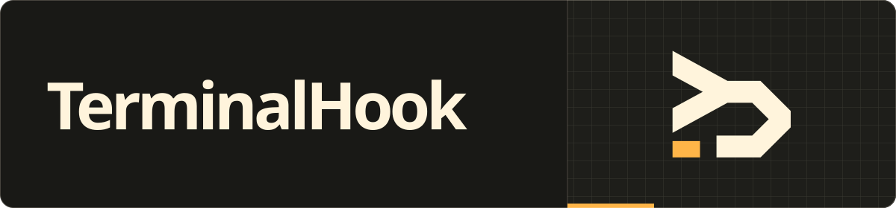
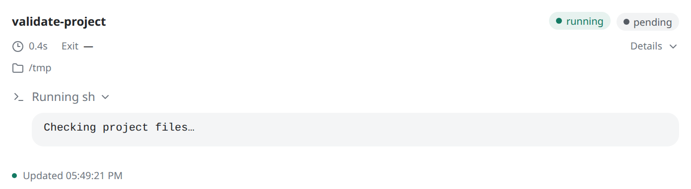
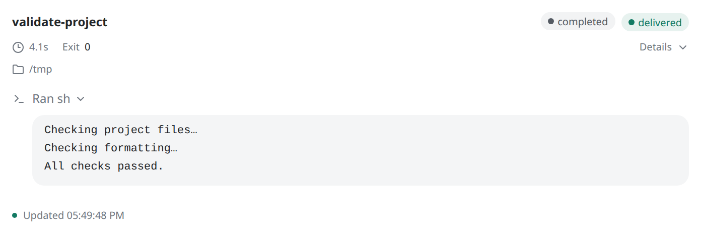
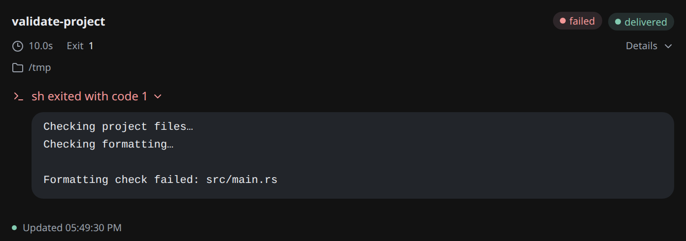

# TerminalHook

[English](README.md) | 简体中文

[](https://github.com/BANG404/Codex_Terminalhook/actions/workflows/ci.yml)
[](LICENSE)



TerminalHook 是 Rust MCP 服务和 Codex 插件，用于持久后台命令、事件驱动任务面板，
以及向原聊天交付完成结果。Codex 会主动将预计耗时较长或完成时间难以预估的任务提交一次，随后结束回合，任务完成后接收已保存结果。
原生 worker 在本地等待，不轮询模型，可跨越 MCP 断连继续运行。

原生测试和分发覆盖 Windows x64、Linux x64/ARM64、macOS Intel/Apple Silicon。
命令使用独立 stdout/stderr 管道，stdin 关闭。Windows Job Object 和 Unix 进程组负责子进程约束。

快速或交互式命令请使用宿主终端。

[任务面板预览](#任务面板预览) · [安装](#安装与升级) · [任务工具](#任务工具) · [发布版本](https://github.com/BANG404/Codex_Terminalhook/releases) · [开发与发布](docs/releasing.zh-CN.md)

## 任务面板预览

在兼容 MCP Apps 的宿主中，任务面板会显示执行状态、交付状态、退出码和命令输出。
以下截图取自浏览器测试宿主。

**运行中**



**成功完成**



**执行失败**



[后台任务指南](docs/background-tasks.zh-CN.md#任务面板预览)

## 安装与升级

### 安装稳定版

确保 Git 和 Codex CLI 已加入 PATH。Windows x64 使用 PowerShell 7，Linux 和 macOS 安装时需要
Python 3.11+。安装器会按系统和架构选择包含预编译产物的 Git marketplace。安装后的 MCP 二进制
无需 Rust、Python 或 Node 即可运行。

获取安装脚本并进入检出目录。

```sh
git clone --depth 1 --branch main https://github.com/BANG404/Codex_Terminalhook.git
cd Codex_Terminalhook
```

在源码根目录运行对应平台的安装器。

**Windows**

```powershell
pwsh -NoProfile -File scripts/install.ps1 -Channel production
```

**Linux 和 macOS**

```sh
sh scripts/install.sh --channel production
```

安装器注册二进制 marketplace，安装并启用 `terminalhook@terminalhook-local`，并配置工具直接调用。
从本地安装迁移时会保留插件 ID 和用户设置。迁移期间注册失败时，安装器会尝试恢复原来源和跟踪分支。
源码检出目录提供安装脚本，marketplace 提供二进制、MCP 配置和运行期技能。

### 桌面共享宿主

如果 `submit_task` 报告无法连接 Windows 或 macOS 桌面端的共享端点，请退出桌面端。
在外部终端进入对应 Release ZIP 的解压目录，或进入 `codex plugin marketplace list` 显示的
`terminalhook-local` Git marketplace 根目录，运行对应平台的启动器。

| 平台 | 启动命令 |
| --- | --- |
| Windows | `pwsh -NoProfile -File ./Start-DesktopSharedHost.ps1` |
| macOS | `sh ./Start-DesktopSharedHost.sh` |

在启动器打开的桌面会话中新开或重新打开聊天，再提交任务。
如果共享宿主仍不可用，请使用宿主终端。参见[后台宿主排查指南](docs/background-tasks.zh-CN.md#连接诊断与桌面兼容性)。

### 升级与配置迁移

Codex 启动时会刷新已配置的 Git marketplace 和已安装插件缓存。也可以手动刷新当前跟踪的渠道。

```sh
codex plugin marketplace upgrade terminalhook-local
```

更新跟随配置中的 Git 分支。旧安装如需补齐当前宿主配置，请从已更新的源码检出目录重新运行安装器并指定原渠道
（Windows 用 `-Channel`，Linux/macOS 用 `--channel`）。本地安装请用 `-Source` 或
`--source` 指定本地包目录。安装器会将 `mcp__terminalhook` 加入
`features.code_mode.direct_only_tool_namespaces`，并在 `submit_task` 及其 TerminalHook
服务均未配置审批模式时，为该工具写入 `approval_mode = "approve"`。升级或迁移后新开聊天以加载当前工具目录。
持久后台 worker 会独立继续运行。
[Codex marketplace 命令](https://learn.chatgpt.com/docs/developer-commands#codex-plugin-marketplace)

如需切换到已发布的预发布渠道，可为安装器的渠道选项传入 `alpha`、`beta` 或 `rc`。
参见[发布渠道与 marketplace 分支](docs/releasing.zh-CN.md#cd--手动发布)。

### 离线安装与本地开发

离线安装或本地开发：从 [GitHub Releases](https://github.com/BANG404/Codex_Terminalhook/releases) 下载匹配系统/架构的 ZIP，解压到固定目录；Windows 执行 `pwsh -NoProfile -File ./install.ps1 -Source .`，Linux/macOS 执行 `sh ./install.sh --source .`。Unix 应使用 `unzip` 等保留可执行权限的解压工具。不指定本地来源时安装器选择 Git 稳定渠道。CI 预览 ZIP 也可从 [Actions artifacts](https://github.com/BANG404/Codex_Terminalhook/actions) 获取。

从源码构建并安装本地快照：

```powershell
pwsh -NoProfile -File scripts/package.ps1
pwsh -NoProfile -File scripts/install.ps1 -Source ./dist/package
```

Linux/macOS 使用 `python3 scripts/package.py --channel development` 构建，再执行 `sh scripts/install.sh --source ./dist/package` 安装。原生源码构建需要固定版本的 Rust 工具链、Python 3.11+，以及带 npm 的 Node.js 20.19+ 或 22.12+，用于打包 Svelte 面板。Linux 二进制使用 glibc（基于 Ubuntu 24.04 构建）；Alpine/musl 和 Windows ARM64 暂不作为发布目标。macOS 产物未签名，也未公证。

`package.ps1` 生成 ZIP 及 `dist/SHA256SUMS.txt`。请保留本地包目录，文件变化后重新运行安装器。

[独立 MCP 示例](examples/standalone.config.toml)包含同样的默认审批配置。同一聊天选用独立服务
或插件之一，避免重复工具。项目中的 `.codex/config.toml` 启用设置适用于已安装插件的受信任项目。
MCP 命令使用本机账户权限，运行在 Codex 内置 shell 的逐命令沙箱之外。

### 卸载

```powershell
codex plugin remove terminalhook@terminalhook-local
codex plugin marketplace remove terminalhook-local
```

## 任务工具

| 工具 | 行为 |
| --- | --- |
| `submit_task` | 使用稳定的 `task_key` 提交预计耗时较长或完成时间难以预估的命令，立即返回任务 ID |
| `list_tasks` | 明确查询原聊天的任务，不打开面板 |
| `get_task` | 按需诊断已保存结果、执行状态和交付回执 |
| `cancel_task` | 取消明确选择的后台任务，清理其进程树 |
| `retry_delivery` | 仅重试提交前交付失败的已保存结果，不重新执行命令 |
| `watch_tasks` | 仅面板可见，订阅当前任务的原生状态事件 |

直接调用 `mcp__terminalhook` 命名空间下的工具。安装器将其加入
`[features.code_mode].direct_only_tool_namespaces` 并保留其他设置；手动安装插件时也需配置宿主。
TerminalHook 通过原生事件与宿主回调交付完成结果。

用户请求范围内的命令预计耗时较长，或可能需要等待且完成时间难以预估时，主动调用 `submit_task`。
用户的任务请求本身足以选择后台执行。直接调用 `submit_task` 即可。
提交新任务需要可连接的共享 Codex daemon、CLI proxy 及宿主提供的 `threadId` 元数据。
工具会在启动前校验这些条件，失败时直接返回具体错误。
Windows 和 macOS 桌面端的启动器见[桌面共享宿主](#桌面共享宿主)。

以下示例提交一条构建命令。

```json
{
  "task_key": "build-project-2026-11-17",
  "program": "sh",
  "args": ["-c", "./build.sh"],
  "cwd": "/absolute/path/to/project"
}
```

Windows 使用本机程序或 `pwsh -NoProfile -Command`，并指定本机绝对工作目录。
PowerShell UTF-8 输出应在同一 PowerShell 进程中加载包内
`skills/terminal-wait/scripts/Initialize-Utf8.ps1`。命令使用参数数组；需要 Shell 语法时显式调用 Shell。

`submit_task` 返回 `task_id`、`worker_pid`、`state_dir`。随后结束回合，等待原聊天接收完成结果；
不要反复调用 `get_task` 或 `list_tasks` 等待。相同键及参数复用已有任务，参数变化会被拒绝。
启动确认丢失时应先检查原任务，再决定是否执行新命令。详见[后台任务指南](docs/background-tasks.zh-CN.md)。

## 输出、期限与恢复

省略 `until` 或使用 `[]` 等待自然退出。可选命名 Rust 正则规则在命中时终止命令；
命中一行输出不能证明自然退出成功。规则名称须唯一、1–128 字节；最多 16 条规则、
模式不超过 4096 字节、捕获组不超过 32 个。拒绝空匹配、前后查找及反向引用。
默认逐行匹配；`match_mode: "window"` 使用有界 64 KiB 窗口跨行匹配。
`streams` 可选择 `stdout` 和/或 `stderr`，不同流独立匹配；逐行匹配拒绝超过 65536 字节的行。

输出按 UTF-8 增量解码，无效字节替换为 U+FFFD；匹配前移除 ANSI CSI/OSC 并归一化 CRLF。
每条流返回的输出尾部不超过 4096 字节；匹配及捕获文本共享 8192 字节预算。
原始 stdout/stderr 保留在任务轮转日志中，每份文件上限 2 MiB，另保留一份备份。
未设置正则的自然退出任务可处理长输出，不累积无界匹配缓冲区。

默认省略 `timeout_ms`。省略或设为 `null` 时，worker 没有执行期限。
只有用户或操作明确要求时才设置 1–31536000000 毫秒的有限期限。
MCP 请求超时只约束提交调用，worker 独立运行。命中、到期、主动取消均在保存结果前清理进程树。
根进程自然退出时也先清理后代，再排空最终输出。Windows 使用带启动分配门控的
kill-on-close Job。Unix 使用进程组，主动创建其他组或会话的后代可能脱离约束。

执行与交付状态相互独立。自然退出结果为 `status: "exited"`，包含真实 `exit_code`；
非零退出码将任务标记为失败。不再提供连接内进程句柄及输出游标。
交付失败保留已保存结果；诊断确认提交前失败后才使用 `retry_delivery`。
交付结果不明确时先核对原聊天，不盲目重发。worker 可跨越 MCP 断连，但重启或 worker 故障后不恢复执行。
面板通过原生状态事件订阅更新，不轮询模型；关闭面板不会停止任务或丢失交付结果。

## 验证

```sh
npm ci
npm run check:ui
npm run build:ui
cargo fmt --check
cargo test --locked
cargo clippy --all-targets --locked -- -D warnings
cargo build --locked
python3 -m unittest discover -s tests -v
npx playwright install chromium
npm run test:ui
python3 scripts/package.py --channel development
python3 scripts/verify_package.py
python3 scripts/verify_long_wait.py
```

协议回归验证仅能发现后台工具，直接调用四个已删除名称均失败；通过独立 loopback 宿主夹具，
覆盖独立执行、聊天隔离、幂等、输出匹配、UTF-8、日志、进程清理和交付恢复，不启动模型回合。
Release 额外要求 65 秒任务跨越 MCP 断连、90 秒 UTF-8 输出及 Windows PowerShell UTF-8 输出。
真实桌面渲染及宿主交付仍需单独接入验收；夹具证据不代表真实桌面结果。
安装及 Git marketplace 验证使用隔离 Codex home。详细门禁、覆盖率、变异和性能检查见
[开发与发布](docs/releasing.zh-CN.md)。

## 实现参考

- [Codex 插件格式与 marketplace](https://developers.openai.com/plugins/build/plugins)
- [官方 Rust MCP SDK](https://github.com/modelcontextprotocol/rust-sdk)
