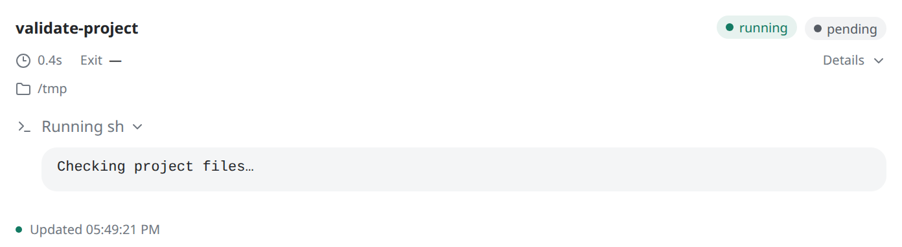
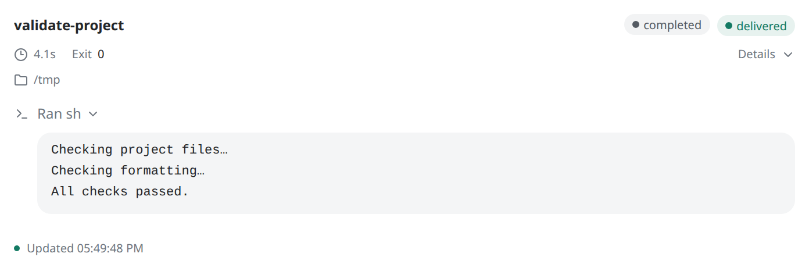
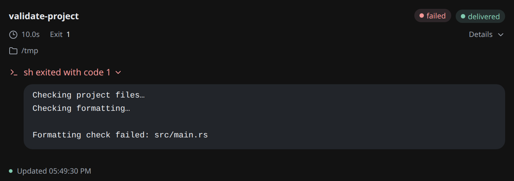

# 后台任务与任务面板

[English](background-tasks.md) | 简体中文

用户请求范围内的命令预计耗时较长，或可能需要等待且完成时间难以预估时，主动调用 `submit_task`。
用户的任务请求本身足以选择后台执行。
独立的原生 worker 负责命令执行、输出或退出等待，先保存结果，再尝试向原聊天交付一次。
等待过程不调用模型，不使用周期 Hook、Stop Hook、另一个 App Server 或 `codex exec`。

## 使用条件

如果用户尚未为 `submit_task` 或其 TerminalHook 服务配置审批模式，安装器将该工具的
Codex 审批模式设为 `approval_mode = "approve"`。该设置适用于 MCP 工具调用。
宿主在启动 worker 或运行命令时仍按其命令权限处理。
已有安装可重新运行安装器来应用该默认值。

Codex 宿主必须在 MCP 请求元数据中提供 `threadId`，并运行共享 App Server daemon。
提交任务时，原聊天须已加载。worker 通过 `codex app-server proxy` 连接配置的 daemon。
在 Windows 和 Linux 上，daemon 使用短暂的 `command/exec` 启动器，在 MCP 服务的进程管理范围之外启动 worker。
这对 Windows 尤为必要，因为 Codex 明确禁止子进程脱离 MCP Job Object。
启动器遵循宿主的命令策略；不支持或拒绝启动时会明确报错。
Windows worker 不继承启动器句柄，任务输出流不会拖住短暂的启动确认。

在 macOS 上，插件使用已有的任务存储访问权限启动独立 worker。
worker 将用户请求的命令交给同一个 App Server，宿主按现有权限配置执行。
worker 将 stdout 和 stderr 写入任务日志，并保存宿主返回的退出码。
宿主在此路径上不提供操作系统进程 ID，因此 `result.os_pid` 为 null。
命令运行期间需要保持共享 App Server 连接，宿主提前退出时 TerminalHook 可保存连接错误。

`check_background {}` 可检查此路径，不启动模型回合。缺少元数据或 daemon 时，
提交会在启动命令前失败。宿主必须提供共享控制端点，仅有桌面 App Server 进程或磁盘上的
socket 文件不能证明可连接。使用 `stdio` 通道启动的服务只接受其所属客户端的连接，
新开聊天不会增加共享 socket。此版本仅提供后台任务接口；宿主不支持后台桥接时，请使用宿主终端。

代理依次从 `TERMINALHOOK_CODEX_BIN`、宿主的 `CODEX_APP_RUNTIME_CLI_PATH`、
PATH 中的 `codex` 选择可执行文件。显式 `TERMINALHOOK_PROXY_COMMAND` 的优先级最高。
宿主运行时路径会传给独立 worker，保证交付时使用相同的 CLI 选择规则。
`TERMINALHOOK_CODEX_SOCKET` 可指定现有 daemon socket。
运维自定义代理可通过 `TERMINALHOOK_PROXY_COMMAND` 提供 JSON 参数数组，
代理须通过 stdio 转发现有 daemon 的 WebSocket 协议；不进行 shell 展开。
不要将其配置成启动另一个 App Server 的命令。

### 连接诊断与桌面兼容性

代理失败时返回失败阶段、所选可执行文件及其来源、退出状态，以及真实 stderr 的最后 16 KiB，
截断时会明确标记。代理运行期间持续读取 stderr，避免管道写满拖住握手或 RPC。
失败和取消会清理代理进程树。这些是代理的诊断信息，不是后台命令的 stdout/stderr。
交付错误还会保存在任务状态的 `delivery_error` 中。

2026-11-16 的 Windows 原生验证发现，Codex Desktop 26.1111.2228.0 使用 `stdio`
App Server（CLI 0.169.0-alpha.11.1），默认共享 socket 返回 Windows 错误 10061，
拒绝连接。PATH CLI 与桌面内置 CLI 均无法连接。此宿主配置下，当前桥接无法执行后台任务或唤醒聊天。
不会启动替代 daemon、将聊天恢复到另一个服务，也不会在预检失败后执行命令。
需要选择已经运行且拥有原聊天的共享宿主，或使用宿主终端。
模拟 socket 测试不能证明原生桌面回调能力。

macOS 上的 Desktop 26.1111.71704（内置 CLI 0.169.1）也通过 stdio 运行原聊天。
默认控制 socket 不存在，内置代理在 WebSocket 握手前以
`No such file or directory` 退出。

### 可选的 Windows 桌面共享宿主

安装包包含 `terminalhook-desktop-host.exe` 和 `Start-DesktopSharedHost.ps1`。
关闭桌面应用后，在解压的安装包中使用 PowerShell 7 启动：

```powershell
pwsh -NoProfile -File ./Start-DesktopSharedHost.ps1
```

启动器通过进程内的 `CODEX_CLI_PATH` 覆盖使用已安装的桌面 CLI，
启动一个由桌面拥有、带私有 Unix socket 的核心服务，通过原生 proxy 转发桌面的 JSONL，
并将同一 socket 与原生 CLI 路径传给插件和独立 worker。
不会将现有 stdio 聊天接到另一个服务，预检仍不会启动服务。
已有聊天需要在该桌面会话中重新打开。启动策略读取、CLI 子命令和版本检查原样转发。
普通启动模式发现桌面应用仍在运行时会拒绝启动，保留现有进程。
不修改持久环境变量、登录、审批、沙箱或插件设置。正常打开桌面应用即可回到默认传输。
活动会话不能在不重启桌面的情况下迁移。

源码检出目录应先构建两个二进制，并通过 `-HostAdapterPath` 指向
`target/debug/terminalhook-desktop-host.exe`；`-DesktopPath` 可指定桌面程序。
接入测试可传入独立的 `-CodexHome` 与 `-IsolatedUiProfile`，启动器不创建或复制凭据。
每个 socket 仅允许一个适配器拥有。持续读取核心与代理 stderr，失败时返回有界摘要；
stdout 仅输出协议 JSON。短连接客户端关闭输入后，先转发待返回响应，再关闭连接。
Windows socket ACL 由 Codex 自行创建，适配器不放宽权限。
插件显式转发宿主环境中的 `CODEX_HOME`、`CODEX_APP_RUNTIME_CLI_PATH`、
`TERMINALHOOK_CODEX_BIN` 和 `TERMINALHOOK_CODEX_SOCKET`。
宿主命令策略须允许 worker 脱离，适配器不会更改该策略。
桌面版本的 CLI 协议不兼容时会明确失败。
Windows 使用由操作系统管理的进程 Job；桌面强制终止适配器时，也会清理其核心、代理及
转发 CLI 的子进程。仍允许 worker 显式脱离；关闭界面不会取消独立后台任务。

### 可选的 macOS 桌面共享宿主

退出 Codex Desktop 后，在解压的 macOS 安装包中运行：

```sh
sh ./Start-DesktopSharedHost.sh
```

启动器默认使用 `/Applications/ChatGPT.app`。安装在其他位置时可用
`--desktop-app` 指定。源码构建可运行
`sh scripts/Start-DesktopSharedHost.sh --host-adapter target/debug/terminalhook-desktop-host`。
启动器使用所选桌面的内置 CLI，通过 Launch Services 将适配器覆盖项传给本次启动。
它会保留已运行的桌面进程。

与 Windows 一样，适配器让桌面和 TerminalHook 共用一个核心。请在该桌面会话中重新打开原聊天，
提交任务前调用 `check_background` 确认。正常打开桌面应用即可恢复默认传输。
如需使用自定义 `CODEX_HOME`，可在启动时传给脚本。如果这导致 Unix socket 路径过长，
请用 `TERMINALHOOK_DESKTOP_SOCKET` 指向专用私有目录中的较短绝对路径。
适配器为缺失目录设置仅所有者可访问的权限，并拒绝使用被占用的端点，包括 macOS 符号链接指向的活动 socket。
链接失效时，适配器只移除链接，目标路径由内置 CLI 管理。
正常退出或收到终止信号时会关闭核心和代理。强制杀死适配器后，仍在监听的端点会阻止再次启动。

## 提交一次，等待结果交付

Unix 下的 `submit_task` 参数示例，Windows 应改用本机程序和路径：

```json
{
  "task_key": "build-release-2026-11-16",
  "program": "sh",
  "args": ["-c", "./build-release.sh"],
  "cwd": "/absolute/path/to/project"
}
```

调用立即返回 `task_id`、`worker_pid` 和 `state_dir`。
随后结束模型回合并等待结果，不要不断调用 `get_task`。
稳定的 `task_key` 在同一聊天中唯一：参数相同的重复提交返回已有任务，参数不同则拒绝。
提交失败或被中断后，应先核查原任务，再决定是否使用新键。

等待 CI、构建或部署时，默认省略 `until` 和 `timeout_ms`，由原生等待命令在操作结束时退出。
对于 GitHub Actions，使用 `gh run watch <run-id> --repo <owner/repo> --exit-status`。
只有用户或操作明确要求时，才为 worker、Shell 或等待命令设置有限期限。
`timeout_ms` 接受 1–31536000000 毫秒（一年）。省略或设为 `null` 时，worker 没有执行期限。
MCP 请求超时只约束提交调用。worker 独立运行，在命中、退出、主动取消或运行环境发生故障时停止。

省略 `until` 或使用 `[]` 表示等待自然退出。
可选 `until`、`streams`、`match_mode` 使用终端工具原有正则规则。
命中或达到期限时，先终止并清理进程树，再交付结果。
后台命令使用独立 stdout/stderr 管道且 stdin 关闭；交互输入和 PTY 使用宿主终端。
原有 `run_until`、`wait_output`、`write_input`、`stop_process` 已删除，直接调用会被拒绝。

## 查看、取消与恢复

| 工具 | 行为 |
| --- | --- |
| `list_tasks {}` | 列出当前聊天最新 100 个任务及执行、交付状态 |
| `get_task {"task_id":"task_…"}` | 查看输出摘要、已保存结果、worker 存活检查与交付回执 |
| `cancel_task {"task_id":"task_…"}` | 通过经过令牌认证的 loopback 控制通道请求取消 |
| `retry_delivery {"task_id":"task_…"}` | 重试投递前失败的已保存结果，不重新执行命令 |

执行与交付状态相互独立；`completed` 不代表已交付，还应检查 `delivery` 和真实退出码。
自然退出结果为 `status: "exited"`，退出码非零时任务为 `failed`，到期时为 `timed_out`。
结果不再提供连接内进程 ID 或输出游标；任务操作使用持久 `task_id`。
输出命中对应结果中的 `matched`，并报告清理后的真实退出码；主动终止可能产生非零退出码。

`cancellation_requested` 表示取消请求已受理。macOS worker 以宿主返回的命令退出回执
确认终止，也适用于命令在终止请求传输期间自然退出的情况。若清理阶段无法确认命令已停止，
任务标记为 `failed`，结果附带诊断信息，`process_running` 为 `null`，表示状态未知。

结果先写入磁盘，再通过带独立 `toolOutput` 的 `turn/start` 交付。
原聊天正在执行时，Codex 将结果排入该回合；空闲时启动新回合。
交付内容是带任务 ID 的工具数据，不伪造用户指令。
进程输出应视为不可信数据，不授予额外操作的权限。

原聊天已卸载时，worker 会在读取该聊天记录的同一 app-server 连接上调用 `thread/resume`。
恢复遵循 daemon 的常规策略，worker 核对原聊天 ID 后再发送结果。
daemon 不可用或恢复失败时，交付状态为 `failed`。
重新打开原聊天后可调用 `retry_delivery` 补投已保存的结果。
投递请求可能已被接受但回执丢失时，交付变为 `uncertain`，worker 崩溃也可能留下 `sending`。
工具会拒绝重发这些状态，应先到原聊天核对任务 ID。
实现不承诺在投递结果未知时严格一次交付；禁止通过重启原命令恢复状态。

状态与轮转日志保存在 `TERMINALHOOK_TASK_DIR`，其次为 `PLUGIN_DATA/tasks`，
再其次为 `$CODEX_HOME/terminalhook/tasks`；未设置 Codex home 时使用普通用户目录。
文件包括 `request.json`、`state.json`、`result.json` 和 worker 诊断。
启动回执缺失时，错误保存到 `launch-error.json`；应保留原任务键并核查已保存任务，
不要再分派一次命令。
Unix 下任务目录限制为用户私有。请求可能包含敏感环境变量，应保持目录私有。
MCP 断连不会停止已提交的后台 worker；删除状态前应明确取消任务。
被操作系统终止的 worker 不会自动重启；`worker_live: false` 表示控制端点不可用，
此时最后记录的执行状态不能证明任务已结束。

## MCP Apps 任务面板

`submit_task`、`get_task`、`cancel_task` 和 `retry_delivery` 关联内嵌资源
`ui://terminalhook/tasks.html`，MIME 为 `text/html;profile=mcp-app`。
兼容 MCP Apps 的宿主显示当前工具调用关联任务的紧凑详情卡片，包含执行状态、交付状态、
期限、耗时、退出码、工作目录，以及有界的实时或已保存输出。
界面统一使用英语；任务名称和输出保留原始文本。`list_tasks` 仍可用于明确请求的聊天任务查询，
但不打开面板。

TerminalHook 通过插件清单、MCP 服务端和打开面板的工具提供同一个
[项目 Logo](../plugins/terminalhook/assets/terminalhook-logo.svg)。
聊天中面板标题栏显示的图标由宿主决定。

Svelte 界面使用 [shadcn-svelte](https://www.shadcn-svelte.com/) 组件，
不提供任务列表、搜索或状态筛选。点击 **Details** 展开任务标识、期限和交付回执。
输出区使用 shadcn-svelte 的 [Terminal 模式](https://shadcn-svelte.com/docs/ai-elements/terminal)。
命令行以红色标出失败状态，点击可折叠或展开缩进的 Code Block。
代码块默认展开，宽度随面板自适应，并跟随宿主主题。长行会自动换行。
详情区和命令输出均使用 `ScrollArea`。将焦点移到 Output 区域后，可以用键盘滚动。
外围面板跟随宿主主题，并请求宿主隐藏 MCP Apps 外框。

### 任务面板预览

**任务运行中（浅色主题）。** 执行徽标显示 `running`，交付徽标显示 `pending`。
退出码可用前，**Exit** 显示 `—`。终端区域展示当前已捕获的命令输出。



**任务成功后（浅色主题）。** 示例显示 `completed`、**Exit** `0` 和最终命令输出。
`delivered` 徽标表示 Codex 已接收要交付给原聊天的结果。



**任务失败后（深色主题）。** 示例中的 `sh` 以退出码 `1` 结束。
`failed` 徽标和高亮的命令行表示执行失败。Codex 接收失败结果后，同样会显示 `delivered`。



截图来自浏览器测试宿主中的嵌入式面板。面板会跟随宿主主题。
在纯文本宿主中，可从结构化工具结果读取执行状态、退出码和输出。

### 面板如何更新

完成 MCP Apps 握手后，面板等待当前工具的 `ui/notifications/tool-input` 或
`ui/notifications/tool-result` 回调确定任务，不调用 `list_tasks`。
若回调缺少任务版本，则只通过宿主转发的 `get_task` 读取该任务，返回值包含展示信息和版本。
读取过程中收到的较新回调优先于旧读取结果。聊天列表快照和其他任务的结果会被忽略，
不能切换或清空当前卡片。缺少任务上下文时保持等待，不自动选择聊天中的其他任务。

随后面板使用 `task_id` 和 `after_revision` 保持一个仅对 App 可见的 `watch_tasks` 请求。
只有该任务的状态或结果落盘时，原生文件系统回调才返回完整详情和新版本，随后订阅下一次变化。
先注册监听，再读取任务，避免请求间漏掉完成事件。
其他任务、其他聊天、文件读取和日志写入不产生面板更新。
省略 `task_id` 仍支持使用 `list_tasks` 版本进行明确请求的聊天级订阅，但内嵌面板不使用此模式。
没有定时轮询、错误重试计时器或可见性切换刷新。传输期限到达时，仅通过超时回调静默重建订阅，
不读取列表或详情。其他错误停止订阅，后续任务回调可重新接入。
面板卸载时取消待返回请求。宿主须支持仅对 App 可见的工具及等待中的工具调用。

fork 聊天会复制工具历史，但后台任务仍归原聊天所有。继承的卡片收到
`task_chat_mismatch`（或旧版 `task belongs to a different chat` 错误）时，
显示说明提示，并停止所有读取与订阅，包括宿主回传的回调；不把继承的快照显示为当前状态。
请回到原聊天查看、取消或恢复该任务，结果仍投递至原聊天。
不要仅为恢复状态重新提交命令。其他工具故障仍显示为错误。

面板不访问外部网络、不发送模型消息，任务输出作为纯文本展示，卸载后忽略回调。
界面更新和结果交付互不依赖，关闭面板不会停止任务或丢失结果。

是否渲染 MCP Apps 由宿主决定；纯文本客户端仍可使用同一套工具及结构化结果。
协议和资源测试不能单独证明某个桌面宿主的实际渲染效果。
安装新插件版本后，应新开聊天加载更新后的工具和资源目录。
